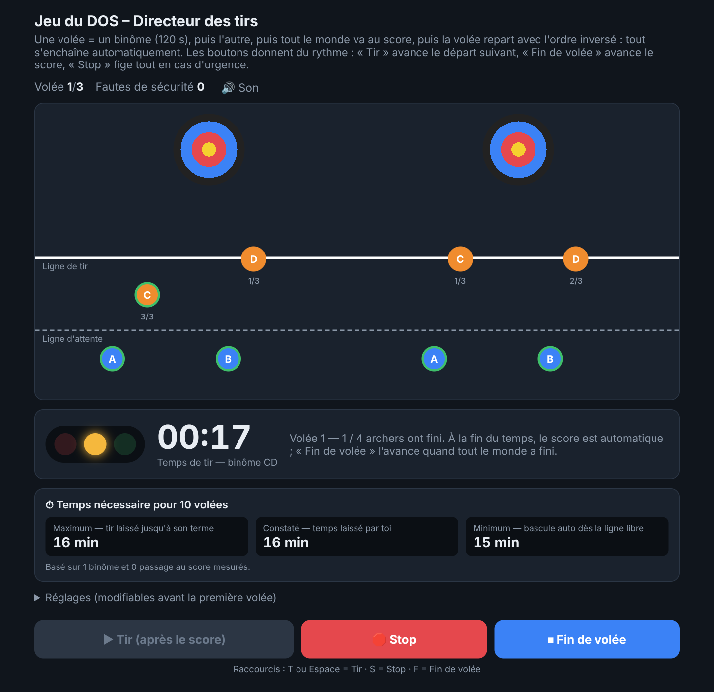
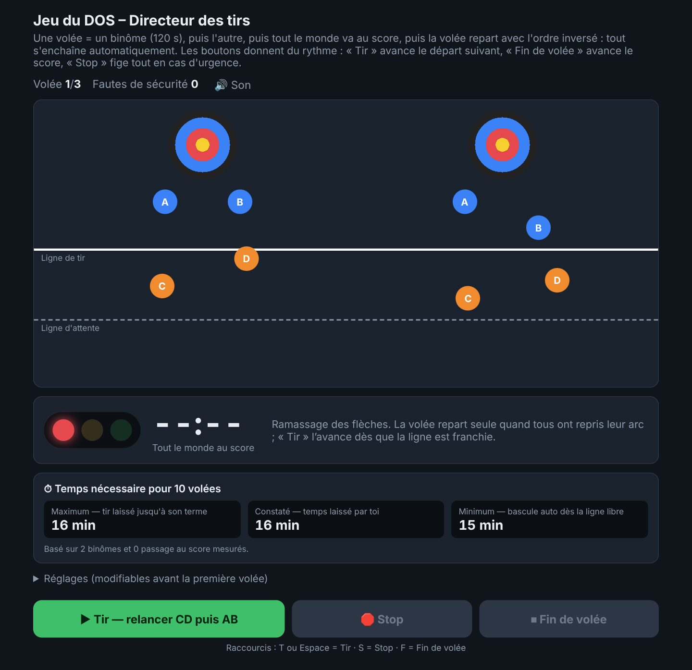

# Jeu du DOS – Directeur des tirs

Serious game pour s'entraîner au rôle de **DOS (Directeur des tirs)** en tir à l'arc : gérer les feux et les signaux sonores, enchaîner les binômes AB / CD, repérer ce qui se passe sur la ligne de tir et décider quand accélérer ou arrêter.





## Jouer

Le jeu tient dans un seul fichier, `index.html`, sans dépendance ni serveur. Il suffit de l'ouvrir dans un navigateur (double-clic).

Pour le mettre en ligne avec GitHub Pages : **Settings → Pages → Build and deployment → Deploy from a branch → `main` / `(root)`**. Le jeu sera accessible à l'adresse `https://ghibau.github.io/DoS/`.

## Déroulé d'une partie

Une **volée** = un binôme tire, puis l'autre, puis tout le monde va au score. La volée suivante repart avec l'ordre inversé (AB → CD, puis CD → AB, etc.).

1. **Tir** : lance les 10 s de préparation du premier binôme. Les archers s'installent sur la ligne de tir.
2. À la fin des 10 s, le feu passe au vert : **2 minutes de tir**. Le feu passe au jaune sur les 30 dernières secondes.
3. Chaque archer tire ses flèches à son rythme. Dès qu'il a fini, il retourne derrière la ligne d'attente sans attendre les autres.
4. À la fin des 2 minutes, **l'appel de l'autre binôme est automatique** : 2 bips, puis 10 s de préparation.
5. À la fin des 2 minutes du second binôme, **la fin de volée est automatique** : 3 bips, tout le monde va au score.
6. Les archers repassent d'abord derrière la ligne d'attente pour **déposer leur arc**, puis vont à la cible (4 archers par cible : A, B, C, D), ramassent leurs flèches et reviennent.
7. Ils reviennent jusqu'au point de départ pour **reprendre leur arc**, et la volée suivante repart automatiquement.

Les boutons ne servent qu'à **donner du rythme** : le jeu avance seul s'ils ne sont pas utilisés.

### Signaux

| Signal | Moment |
|---|---|
| 2 bips | Lancement des 10 s de préparation d'un binôme |
| 1 bip | Fin des 10 s : début du temps de tir |
| 3 bips | Fin de volée : tout le monde va au score |
| 6 bips rapides + rouge clignotant | Stop (urgence) |

## Les trois boutons

| Bouton | Raccourci | Effet |
|---|---|---|
| **Tir** | `T` ou `Espace` | Avance le départ suivant : appelle l'autre binôme avant la fin des 2 minutes, ou relance la volée dès que tous ont repassé la ligne de tir. Reprend le jeu après un Stop. |
| **Stop** | `S` | Urgence : fige le chrono, feu rouge clignotant. Les archers continuent de bouger, ce qui laisse le temps de libérer la ligne. Après un Stop pendant le tir, il reprend avec le temps restant. |
| **Fin de volée** | `F` | Avance le score quand tout le monde a fini de tirer. |

## Ce qui est évalué

- **Faute de sécurité** : un archer est encore sur la ligne de tir quand le feu passe au vert, ou tu appuies sur « Tir » alors qu'il reste quelqu'un devant la ligne.
- **Fin de volée prématurée** : « Fin de volée » alors qu'un archer n'a pas fini de tirer, ou que le second binôme n'a pas tiré.
- **Stop justifié ou non** : justifié si un archer de l'autre binôme était encore sur la ligne.
- **Traînards** : après sa dernière flèche, un archer reste parfois quelques secondes sur la ligne (« Je range mon matériel… », « Je regarde mon score dans ma lunette… »). À la fin des 2 minutes, il quitte dans tous les cas le pas de tir.
- **Retardataires à la cible** : un archer peut mettre plus de temps à ramasser ses flèches.

Un bilan s'affiche à la fin de la partie.

## Compteur : temps nécessaire pour N volées (10 par défaut)

| Estimation | Hypothèse |
|---|---|
| **Maximum** | Temps de tir laissé jusqu'à son terme systématiquement, aucun bouton utilisé ; la relance repart quand tous ont repris leur arc. |
| **Constaté** | Temps de tir réellement laissé par le joueur et relances réellement constatées. |
| **Minimum** | Bascule automatique dès que les archers ont quitté la ligne de tir, et relance dès qu'ils repassent la ligne de tir après avoir récupéré leurs flèches. |

Le maximum s'affiche dès le départ d'après les réglages. Le constaté et le minimum apparaissent après le premier binôme et s'affinent au fil de la partie. Le temps de retour du score est estimé tant qu'il n'a pas été mesuré.

## Réglages

Modifiables avant la première volée (menu « Réglages »).

| Réglage | Valeur par défaut |
|---|---|
| Préparation | 10 s |
| Temps de tir par binôme | 120 s |
| Flèches par volée | 3 |
| Temps moyen par flèche | 20 s (rythme propre à chaque archer, avec variations) |
| Jaune à | 30 s restantes |
| Temps à la cible | 20 s |
| Volées à jouer | 3 |
| Volées pour l'estimation | 10 |

## Limites

Il s'agit d'une **simulation simplifiée** pour la formation, pas d'un outil officiel : les durées, les signaux et les situations sont des hypothèses de travail à confronter au règlement en vigueur.

## Structure du dépôt

```
index.html          le jeu (HTML, CSS et JavaScript dans un seul fichier)
README.md           ce fichier
capture.png         capture d'écran (second binôme en plein tir)
capture-score.png   capture d'écran (passage au score)
apercu.png          image affichée quand le lien du jeu est partagé (balises Open Graph de index.html)
```
